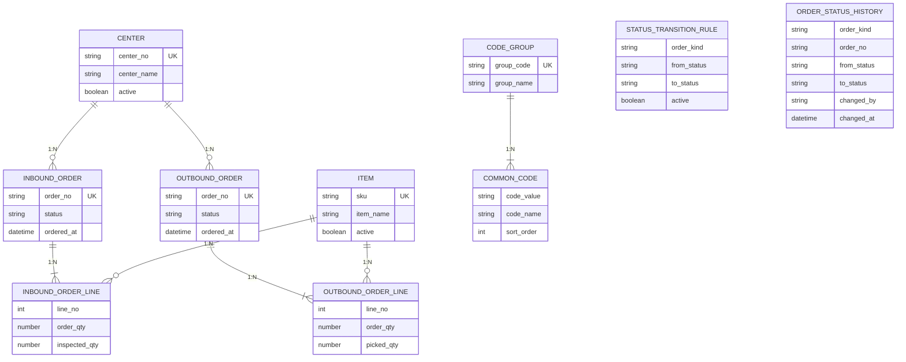

# WMS 개념 모델 (F1~F4)

| 항목 | 내용 |
|------|------|
| 문서 ID | wms-model |
| 버전 | 2.0 (Lab 2-1 개념 모델) |
| 기준 PRD | `docs/01.analysis/01.rfp/wms_prd.md` §7 (설계 입력), §4·§6 보조 |
| 범위 | F1~F4만. F5~F7·`wms_prd-inventory-flow.md` 제외 |
| 상태 | **개념 모델** — 본 단계에서는 DDL 미작성 |

엔터티·속성 이름은 논리명이다. 물리 테이블·컬럼명은 이후 DDL 단계에서 `.cursor/rules/06-database.mdc`에 맞춰 정한다.

---

## 1. 엔터티 목록과 핵심 속성

PRD §7.1 관리 대상 8항목을 엔터티로 전개한다. (공통코드는 그룹·코드 2엔터티)

### 1.1 기준정보

#### Center (센터)

| 속성 | 의미 | 비고 |
|------|------|------|
| 센터 번호 | 업무 식별자 | 중복 불가 (§7.1, §7.2) |
| 센터명 | 표시명 | |
| 사용 여부 | 활성/비활성 | 삭제 대신 사용 여부 (§7.2) |

입·출고를 센터 단위로 운영·필터한다 (§6, §7.3).

#### Item (품목)

| 속성 | 의미 | 비고 |
|------|------|------|
| SKU | 업무 식별자 | 중복 불가 |
| 품목명 | 표시명 | |
| 사용 여부 | 활성/비활성 | 삭제 대신 사용 여부 |

상품 단위로 라인 수량을 관리한다 (§6, §7.1).

---

### 1.2 공통코드

#### CodeGroup (코드그룹)

| 속성 | 의미 | 비고 |
|------|------|------|
| 그룹 코드 | 그룹 업무 식별자 | 예: 입고상태, 출고상태, 주문종류 |
| 그룹명 | 표시명 | |
| 사용 여부 | 활성/비활성 | |

#### CommonCode (공통코드)

| 속성 | 의미 | 비고 |
|------|------|------|
| (소속 그룹) | 코드그룹 참조 | |
| 코드 값 | 그룹 내 식별자 | 예: `00`, `10`, `INBOUND` |
| 코드명 | 표시명 | |
| 표시 순서 | 그룹 안 정렬 | §7.1 |
| 사용 여부 | 활성/비활성 | |

상태·구분값은 공통코드로 관리하고, 테이블 정의에 코드 목록을 고정하지 않는다 (§6, §7.2).

**필요 그룹(개념)**

| 그룹 | 용도 | 값 흐름(§6) |
|------|------|-------------|
| 입고 상태 | 입고 주문 상태 | 주문생성 → 검수중 → 검수완료 → 입고확정 |
| 출고 상태 | 출고 주문 상태 | 주문생성 → 피킹중 → 피킹완료 → 출고확정 |
| 주문 종류 | 이력·전이 규칙 구분 | 입고 / 출고 |

---

### 1.3 입고

#### InboundOrder (입고 주문)

| 속성 | 의미 | 비고 |
|------|------|------|
| 주문번호 | 업무 식별자 | 중복 불가. 화면에서 생성하지 않음(외부 수신) |
| 센터 | 처리 센터 | N:1 → Center |
| 상태 | 현재 상태 | 공통코드(입고 상태) 참조 |
| 주문 일시 | 주문 시각 | |

#### InboundOrderLine (입고 주문 라인)

| 속성 | 의미 | 비고 |
|------|------|------|
| (소속 주문) | 입고 주문 | N:1 → InboundOrder |
| 라인 순번 | 주문 내 식별 | 주문 안 중복 불가 |
| 품목 | 상품 | N:1 → Item |
| 주문 수량 | 요청 수량 | ≥ 0 |
| 검수 확정 수량 | 검수 결과 수량 | ≥ 0, ≤ 주문 수량 |

---

### 1.4 출고

#### OutboundOrder (출고 주문)

입고 주문과 동일 구조: 주문번호(중복 불가), 센터, 상태(출고 상태 공통코드), 주문 일시. 화면 생성 없음.

#### OutboundOrderLine (출고 주문 라인)

입고 라인과 대칭: 라인 순번, 품목, 주문 수량, **피킹 수량**(≥ 0, ≤ 주문 수량).

---

### 1.5 상태 전이·이력

#### StatusTransitionRule (상태 전이 규칙)

| 속성 | 의미 | 비고 |
|------|------|------|
| 주문 종류 | 입고 / 출고 | |
| 출발 상태 | from | |
| 도착 상태 | to | |
| 사용 여부 | 규칙 on/off | 끄고 켤 수 있음 (§7.1) |

허용 전이만 목록으로 둔다. F4에서 이 목록으로 검증한다.

| 주문 종류 | 허용 전이(§6) |
|-----------|----------------|
| 입고 | 주문생성→검수중, 검수중→검수완료, 검수완료→입고확정 |
| 출고 | 주문생성→피킹중, 피킹중→피킹완료, 피킹완료→출고확정 |

#### OrderStatusHistory (상태 이력)

| 속성 | 의미 | 비고 |
|------|------|------|
| 주문 종류 | 입고 / 출고 | |
| 주문번호 | 대상 주문 | 입·출고 모두 가리킴 (§7.2) — 참조 방식은 확인 질문 |
| 이전 상태 | from | |
| 이후 상태 | to | |
| 변경자 | 수행자 | |
| 변경 사유 | 선택 | |
| 변경 일시 | 시각 | |

상태 변경과 이력 기록은 같은 트랜잭션(F4, §7.2).

---

## 2. 업무 식별자

| 엔터티 | 업무 식별자 | 유일 범위 |
|--------|-------------|-----------|
| Center | 센터 번호 | 전역 |
| Item | SKU | 전역 |
| CodeGroup | 그룹 코드 | 전역 |
| CommonCode | 그룹 + 코드 값 | 그룹 내 |
| InboundOrder | 주문번호 | 입고 주문 전역 |
| InboundOrderLine | (부모 주문) + 라인 순번 | 주문 내 |
| OutboundOrder | 주문번호 | 출고 주문 전역 |
| OutboundOrderLine | (부모 주문) + 라인 순번 | 주문 내 |
| StatusTransitionRule | 주문종류 + from + to | 전역 |
| OrderStatusHistory | (업무 UK 없음) | 조회키: 종류+주문번호+시간 |

§7.2: 사람이 읽는 번호(업무 식별자)와 시스템 식별자(대리키)는 구분한다. 대리키는 DDL 단계에서 부여한다.

---

## 3. 관계와 카디널리티

| # | 관계 | 카디널리티 | 설명 |
|---|------|------------|------|
| R1 | Center → InboundOrder | **1 : N** | 한 센터에 여러 입고 주문 |
| R2 | Center → OutboundOrder | **1 : N** | 한 센터에 여러 출고 주문 |
| R3 | InboundOrder → InboundOrderLine | **1 : N** | 헤더–라인 |
| R4 | OutboundOrder → OutboundOrderLine | **1 : N** | 헤더–라인 |
| R5 | Item → InboundOrderLine | **1 : N** | 한 품목이 여러 입고 라인에 등장 |
| R6 | Item → OutboundOrderLine | **1 : N** | 한 품목이 여러 출고 라인에 등장 |
| R7 | CodeGroup → CommonCode | **1 : N** | 그룹–코드 |
| R8 | InboundOrder ↔ Item | **M : N** | 라인이 연결 엔터티로 해소 |
| R9 | OutboundOrder ↔ Item | **M : N** | 동일 |
| R10 | StatusTransitionRule → (주문 헤더) | 논리 참조 | 전이 검증 시 조회. 물리 소속 관계 아님 |
| R11 | OrderStatusHistory → 주문 | **N : 1** (논리) | 입·출고 공용. 참조 방식은 설계 결정 (§7.2) |

점선(논리): `ORDER_STATUS_HISTORY`는 주문 종류에 따라 입고 또는 출고 주문번호를 가리킨다.  
주문 헤더의 상태는 각각 입고/출고 상태 공통코드를 참조한다(목록을 DDL에 고정하지 않음).

---

## 4. PRD §7.1 대응

| §7.1 | 본 모델 |
|------|---------|
| 1. 센터 | Center |
| 2. 품목 | Item |
| 3. 입고 주문 | InboundOrder |
| 4. 입고 주문 라인 | InboundOrderLine |
| 5. 출고 주문 / 라인 | OutboundOrder, OutboundOrderLine |
| 6. 상태 전이 규칙 | StatusTransitionRule |
| 7. 상태 이력 | OrderStatusHistory |
| 8. 공통코드 | CodeGroup, CommonCode |

누락 없음. 주문–품목 M:N은 라인으로 해소.

---

## 5. 확인 질문

요구사항만으로 결정이 애매한 항목이다. 괄호는 **제안**.

| # | 질문 | 영향 | 제안 |
|---|------|------|------|
| Q1 | 상태 이력이 입고·출고를 모두 가리킬 때 참조 방식은? (§7.2가 설계자 결정을 요구) | 이력·F3 조회 | **주문종류+주문번호 논리 참조** (단일 부모 FK 불가). 이유: 공용 이력·대시보드에 유리 |
| Q2 | 주문 상태·전이 from/to에 공통코드 **물리 FK**를 둘까? | 무결성 vs 유연성 | **논리 참조만** (입·출고 코드그룹이 갈라짐, §7.2 “목록 고정 금지”) |
| Q3 | 한 주문 안 동일 SKU를 여러 라인에 허용할까? | 라인 UNIQUE | **허용** (PRD는 라인 순번 유일만 요구) |
| Q4 | 검수/피킹 수량은 누가·언제 갱신하나? (F1~F4는 상태 전이 중심) | 라인 API 범위 | **초기 데이터·조회**. 수량 갱신 API는 F1~F4 밖일 수 있음 |
| Q5 | 주문 생성 시 `주문생성` 상태의 초기 이력 행을 넣나? | F3 추적 | **불필요**. 전이 성공 시에만 이력 INSERT |
| Q6 | 입·출고 주문번호를 전역(한 네임스페이스) 유일로 강제할까? | UK·이력 | **종류별 테이블(또는 종류 범위) 유일**. 관례상 접두로 충돌 회피, 이력은 종류와 함께 조회 |
| Q7 | 수량은 정수만인가, 소수 허용인가? | 타입 | **정수** (PRD 예시·실습 전제에 맞춤) |
| Q8 | 거래처(발주처)·재고·로케이션 엔터티가 필요한가? | 범위 | **이번 범위(F1~F4) 없음** (§8 확장 제외) |
| Q9 | 비활성 센터/품목을 가리키는 기존 주문은 허용할까? | 참조 무결성 | **기존 주문 유지 허용**. 신규는 활성 마스터만(시드) |
| Q10 | 최근 이력에 센터 필터가 필요한가? (§7.3 요약은 센터별·상태별) | 이력 속성 | **이력에 센터 비정규화 불필요**. 요약은 주문 헤더 집계 |

DDL은 위 확인 질문이 합의된 뒤 작성한다. **본 단계는 DDL을 만들지 않는다.**
